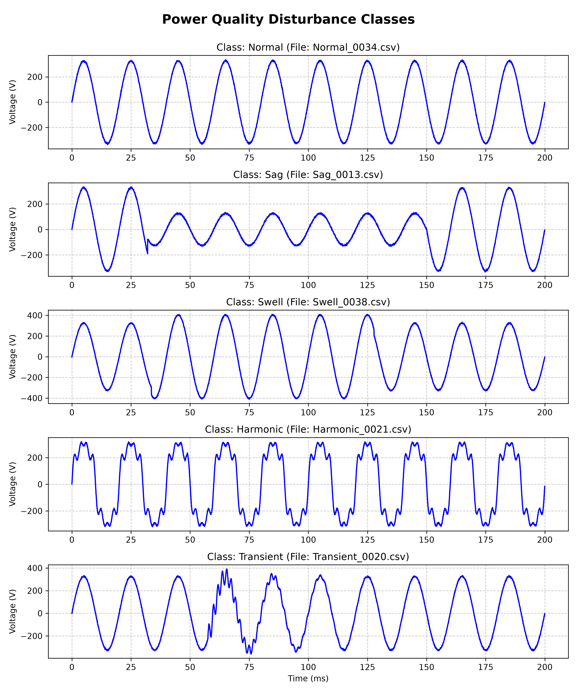
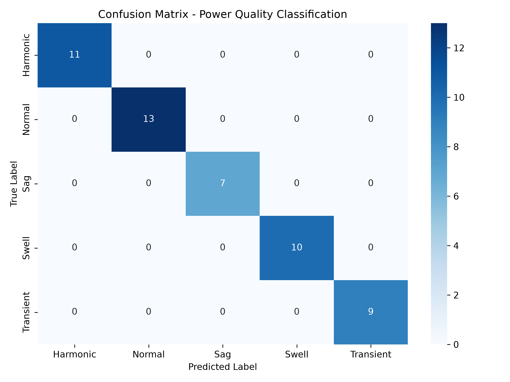

# AI-Based Smart Power Quality Analyzer (TinyML & Simulation)


## 📌 Overview
This project is a complete simulation-based pipeline for detecting and classifying Power Quality (PQ) disturbances in real-time. It generates synthetic AC waveforms, extracts engineering features, trains a Machine Learning model, and converts it to pure C code for deployment on resource-constrained microcontrollers (TinyML) like STM32.

## 🏗️ System Architecture
1. **Simulation:** Generates 50Hz AC voltage waveforms with injected disturbances (Sag, Swell, Harmonic, Transient) using NumPy.
2. **Feature Extraction:** Calculates RMS, Total Harmonic Distortion (THD), and Frequency using SciPy.
3. **Machine Learning:** Trains a Random Forest Classifier (Scikit-Learn) to detect faults.
4. **TinyML Deployment:** Converts the trained model to optimized C code (`model.h`) for edge inference on an MCU.

## 📊 Results
*   **Model Accuracy:** 100% (on 20% test split)
*   **Inference Latency:** < 1 ms (estimated on STM32)
*   **Memory Footprint:** < 10 KB (pure C code, zero dynamic allocation)

### Waveform Visualization


### Confusion Matrix


## 🛠️ Technologies Used
*   **Languages:** Python, C
*   **Simulation & ML:** NumPy, Pandas, SciPy, Scikit-Learn, Matplotlib, Seaborn, emlearn
*   **Target Hardware:** STM32 / ARM Cortex-M

## 🚀 How to Run (Simulation)
1. Clone the repository:
   ```bash
   git clone https://github.com/YOUR_USERNAME/AI-Power-Quality-Analyzer.git
   cd AI-Power-Quality-Analyzer